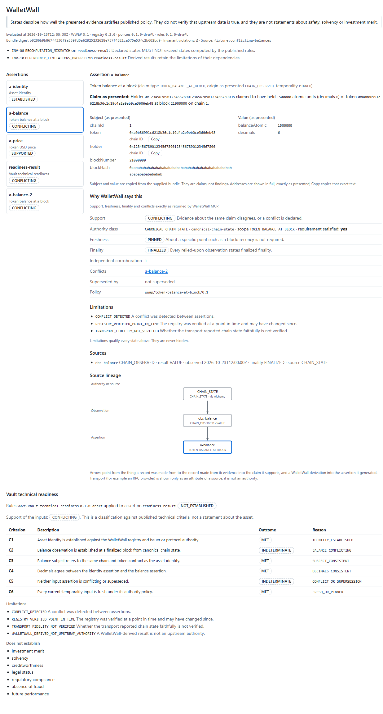

# WalletWall

Stablecoin intelligence and vault readiness for GitHub Copilot.

WalletWall is a local, read-only Copilot plugin and MCP server for inspecting stablecoin identity, source lineage, conflicts and vault-readiness signals.

Status: Pre-release  
WWEP: 0.1  
Registry: point-in-time verified

WalletWall does not sign, custody, trade, broadcast transactions, provide investment advice or certify regulatory compliance. Nothing here has been published to npm or a Copilot marketplace. Source and release artifacts are on GitHub Releases ([v0.2.0](https://github.com/Wallet-Wall/walletwallrus-copilot/releases/tag/v0.2.0)), and the local MCP server's metadata is listed in the official MCP Registry as `io.github.Wallet-Wall/walletwall`.

> Inspect stablecoin identity, wallet state, source lineage, conflicts, and vault readiness through WalletWall MCP.

## What you get

| Part | What it is |
| --- | --- |
| **WalletWall** (plugin) | The Copilot plugin in `plugin/`: manifest, skill, bundled MCP server and canvas |
| **WalletWall MCP** | A local, offline, read-only MCP server (stdio only) with six tools and six static resources. Exact contract: `security/tool-manifest.json` |
| **WalletWall** (canvas) | A panel that shows one bundle: Sources, Support, Freshness, Conflicts, Limitations and "Why WalletWall says this", exactly as WalletWall MCP returned them |
| Skill | Tells the model to report what the sources support, surface limitations and never over-claim |

| Tool | Purpose |
| --- | --- |
| `resolve_asset` | Registry lookup by chain ID + address, or symbol candidates. Symbols are never identity |
| `normalize_observation` | Canonical observation, RFC 8785 + SHA-256 digests, exact decimal rendering |
| `inspect_evidence` | Support, freshness, finality, authority, limitations and conflicts per assertion |
| `check_invariants` | The 13 WWEP invariants plus declared-versus-computed |
| `trace_provenance` | W3C PROV-JSON-shaped source lineage for one assertion |
| `assess_vault_readiness` | `VAULT_TECHNICAL_READINESS` rules 0.1.0-draft |



## What it will not say

A support state such as `ESTABLISHED` means the presented evidence satisfies a published policy. It does not mean the evidence is true.

> WalletWall reports what identified sources and authority policies support. A supported result does not guarantee that upstream information is correct.

The bundled registry (five stablecoin deployments on Ethereum, Base and Arbitrum) is a point-in-time snapshot verified on 2026-10-24. It is not live or current-chain data. WalletWall fetches nothing at runtime. See `docs/REGISTRY_SOURCES.md`.

## Privacy

> WalletWall-controlled code does not retain MCP query history or transmit query data to WalletWall infrastructure. GitHub Copilot and the selected model provider may independently process prompts and tool data under their own policies.

Wallet addresses you put in a prompt are processed by Copilot and the model provider, not by WalletWall. Details and the limits of what is tested: `PRIVACY.md`, `docs/PLUGIN_PATH_PRIVACY.md`.

## Install

From this repository on GitHub (verified with GitHub Copilot CLI 1.0.103 against the public repository, with no credentials):

```text
copilot plugin marketplace add Wallet-Wall/walletwallrus-copilot
copilot plugin install walletwall@walletwall
```

Or from a local checkout:

```text
copilot plugin marketplace add <path to this checkout>
copilot plugin install walletwall@walletwall
```

The marketplace and the plugin are both named `walletwall`. Verified with GitHub Copilot CLI 1.0.103: `copilot plugin list --json` reports `walletwall` from marketplace `walletwall`, version 0.2.0. This repository is the plugin source only; the plugin is not an accepted listing in any GitHub or Copilot marketplace or catalog. The official MCP Registry listing covers the MCP server's metadata only and is discovery, not endorsement or certification.

In the GitHub Copilot app: **Customize → Plugins → marketplace settings → add this repository → Install**. A new session then has the six WalletWall MCP tools, the skill and the WalletWall canvas. What was verified on Windows and what was not: `docs/DESKTOP_INSTALL_PROOF.md`. Requires `node` on `PATH`.

## Develop

Requires Node.js 22.18 or newer (tested on 24).

```text
npm ci
npm run verify
```

Generated files are committed and verified in CI on Linux and Windows. See `CONTRIBUTING.md` for which command regenerates what.

## Documents

`CONTRIBUTING.md` · `SECURITY.md` · `PRIVACY.md` · `BOUNDARIES.md` · `THREAT_MODEL.md` · `DATA_SOURCES.md` · `docs/REGISTRY_SOURCES.md` · `docs/DEPENDENCY_POLICY.md` · `docs/PUBLIC_RELEASE_AUDIT.md` · `docs/PUBLIC_DISCOVERY_READINESS.md` · `TRADEMARKS.md` · `LICENSE`

Layout: `plugin/` (the plugin), `packages/mcp/` (engine, registry, authority policies, tests), `spec/` (WWEP 0.1 draft), `conformance/` (conformance and adversarial corpus), `security/` (manifests and hashes), `evals/` (Copilot agent evals, separate from conformance), `docs/`.

## License

Apache License 2.0 (`LICENSE`), copyright 2026 WalletWall. The license covers the software and documentation in this repository. It does not grant rights to the WalletWall name, logos or marks: see `TRADEMARKS.md`. Third-party components keep their own licenses (`plugin/THIRD_PARTY_NOTICES.md`).
