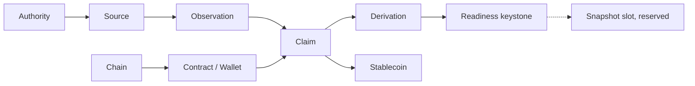

# WalletWall canvas design system

The visual and interaction rules of the WalletWall canvas (`plugin/com.github.copilot/extensions/walletwall-evidence-explorer/`). The canvas contract (what it may and may not show or do) is in `canvas/README.md`; this document is about how it looks and moves, and why.

The design goal is *architectural blueprint + masonry system + vault instrumentation*: a cream field, charcoal structure, terracotta for the selected path only, and pieces whose shape says what they are.

## Brand sources

Nothing is redrawn. Every value or asset comes from a WalletWall brand source; `canvas/brand/brand-sources.json` records the repository, commit, path, SHA-256 and the exact transformation of each file, and `scripts/gen-canvas-brand.ts` refuses to embed a file whose hash differs.

| What | Source | Shipped as |
| --- | --- | --- |
| Colour tokens | `Wallet-Wall/walletwall-audio-visual-docs` `contracts/walletwall-brand.json` (values copied from the WalletWall app's canonical `src/index.css` `:root` and `src/theme.js`, drift-checked there) | CSS custom properties in `styles.mjs` |
| Mark | `Wallet-Wall/walletwall-audio-visual-docs` `assets/brand/walletwall-brick-wallet.png` (the reviewed brick-wallet mark) | `canvas/brand/walletwall-brick-wallet-96.png`, uniformly downscaled, embedded as a `data:` URI |
| Guide | `Wallet-Wall/walletwall-audio-visual-docs` `blender/proof/reference/inspect.png`, `perch.png` (WalletWallaby renders) | `canvas/brand/walletwallaby-*.png`, cropped to the character and downscaled |
| Fonts | The WalletWall app's `:root` (`--font-display` Sora, `--font-ui` Manrope, `--font-mono` IBM Plex Mono) and its `package-lock.json` (`@fontsource-variable/sora` 5.2.8, `@fontsource-variable/manrope` 5.2.8, `@fontsource/ibm-plex-mono` 5.2.7) | The packages' latin `woff2` files, unmodified, in `canvas/brand/fonts/`, embedded as `data:` URIs |

The cream horizontal "Wallet Wall" lockup is not used. The mark is never recoloured, stretched or redrawn; the brand pack has no vector master, so the canvas uses the raster mark.

Fonts are used under the SIL Open Font License 1.1; the license texts ship in `plugin/THIRD_PARTY_NOTICES.md`. The WalletWall mark and WalletWallaby are WalletWall brand assets: the software license grants no right to them (`TRADEMARKS.md`).

### Offline by construction

The page makes no font, image, stylesheet or script request. Its CSP is `default-src 'none'`, scripts and styles by nonce, `connect-src 'self'`, and `font-src data:` / `img-src data:` for the embedded brand assets only. There is no `@import`, no CDN and no remote image. Tests: `packages/mcp/test/canvas/design.test.ts` (asset hashes, `data:`-only sources) and `explorer.test.ts` (CSP).

## Colour tokens

| Token | Value | Role on the canvas |
| --- | --- | --- |
| `--ww-bg` | `#F2ECDF` | Paper: the page field |
| `--ww-surface` | `#F8F2E4` | Panels, piece fills |
| `--ww-cream` | `#F5F1E8` | Measurement tiles, address plates, text on dark pieces |
| `--ww-charcoal` | `#2B2B2E` | Structure: piece outlines, rails, chain anchors, active mode |
| `--ww-charcoal-rail` / `-border` | `rgba(43,43,46,0.28)` / `0.22` | Connections, chip outlines, dividers |
| `--ww-accent` | `#BF4E32` (terracotta) | **Selection only**: the selected piece, its dependency path, focus rings |
| `--ww-accent-dark` | `#8B3120` | Conflict seams, attention outlines, eyebrows |
| `--ww-stone` / `-low` | `#e9d3ad` / `#b99568` | Authority plates, wallet bricks, readiness keystone |
| `--ww-mortar` | `#f5ead4` | Mortar between Wallprint and assembly courses |
| `--ww-brick` | `#b94a31` | Stablecoin brick |
| `--ww-warm-stone` | `#D8D3C8` | Recessed (stale) pieces |
| `--ww-ink` / `--ww-muted-text` | `rgba(30,26,20,0.88)` / `0.66` | Text |

No new hue is introduced. There is no green "good" and no red "bad": terracotta never means approval or alarm.

## Typography

| Role | Family | Use |
| --- | --- | --- |
| Display | Sora Variable (600) | Product name, section titles |
| UI | Manrope Variable (500 to 700) | Body, labels, piece names, controls |
| Mono | IBM Plex Mono (400, 500) | Addresses, hashes, IDs, block numbers, reason codes |

Eyebrows: 10.5 px, 700, 0.16 em tracking, uppercase, `--ww-accent-dark`. Layer labels on The Wall: 9 px, 700, 0.18 em tracking.

## Geometry

1 px hairline borders; radii 1 px (controls, chips) and 2 px (panels); masonry bricks (stablecoin, wallet) use 6 px as the texture layer. A faint 24 px blueprint grid sits under The Wall only.

## The Wall

The centre of the panel: a deterministic force-directed graph of one bundle.

Columns are semantic: authorities, sources, observations, claims, derivation, then the **vault readiness chamber** (a framed area holding the keystone and the reserved snapshot slot). The subjects of the claims form the **foundation course** below. Edges point from what a piece rests on to the piece resting on it.

### Node taxonomy

| Piece | Drawn as | From |
| --- | --- | --- |
| Issuer or protocol authority | Chamfered seal plate (stone) | A source's `authorityId`, or the issuer an identity claim names (dashed: "named, no source") |
| Source | Plate with a charcoal top rail | `sources[]`, labelled by kind and transport |
| Observation | Measurement tile with ruler ticks | `observations[]`; a `NO_RESULT` or `ERROR` result is hatched and dashed |
| **Wallmark** | Plate with the round brick seal of the mark | The `ASSET_IDENTITY` claim |
| Claim | Fitted piece (tab on the right, socket on the left) | Other assertions |
| WalletWall derivation | Hinge plate | `derivations[]` |
| Vault readiness | Keystone, seated on a line | The `VAULT_TECHNICAL_READINESS` claim |
| Conflict | Split seam (two charcoal-red halves) | An evaluation's `conflictsWith` |
| Missing piece | Empty hatched slot | A referenced record the bundle lacks |
| Snapshot slot | Dashed reserved slot | Always, next to a keystone; nothing fills it yet |
| Stablecoin | Terracotta brick | The symbol an identity claim presents ("as presented") |
| Contract | Monospace address plate | Identity `address`, claim `token` |
| Wallet | Stone address brick | Balance `holder` |
| Chain | Charcoal anchor | `chainId` |

### Edge taxonomy

| Edge | Line | Part of "Why" path |
| --- | --- | --- |
| speaks through, observed, supports, is an input to, generates | charcoal, arrow | yes |
| is missing for | dashed | yes |
| conflicts at | terracotta-dark, split in the middle | yes |
| is superseded by | dotted | yes |
| subject, anchors, names, issuer | faint | no |
| reserves (keystone to snapshot slot) | dashed, no arrow | no |

### Layout and interaction

- One deterministic simulation (`forceLayout` in `wall.mjs`): link springs, column and band anchors, rectangle collision, fixed tick count, no randomness, no clock. The server runs it to place the pieces; the page replays the identical function so The Wall *assembles* into exactly those positions (tested).
- A second, portrait layout (`portraitLayout` in `wall.mjs`) for phones and portrait tablets: the same pieces and connections read top to bottom in bands (authorities and sources, observations, claims and derivation, Wallmark, vault readiness, foundation). It is computed once on the server without simulation: each band packs its pieces into centred rows, ordered by where the force layout put them. Each piece carries a compact face for it, slightly smaller and with short words (Issuer, Balance, Price, Wallet, Chain, Readiness); the state or classification stays on the face, and an assertion ID or a full address never does (a contract or wallet face shows a shortened address; the full value is in the piece's accessible name and detail). Nothing is dropped to fit (tested).
- Pieces never overlap at rest (tested). The Wall fits its frame: the server's view box covers every piece, so the whole graph, readiness keystone included, is visible at load without scrolling (tested for every fixture). **Zoom** (−, +, Fit; 150 %, 200 %, 300 %) narrows the view box inside the same frame, and dragging the background pans; a piece reached by keyboard or by a link is brought into view. A dragged piece stays inside the frame.
- Click, Enter or Space selects. A claim piece selects that assertion (the agent's `get_view` follows); any other piece opens its own detail. Arrow keys move between pieces spatially; Escape clears. Drag pins a piece where it is dropped while its neighbours relax and stop; **Reset layout** restores every position.
- **Overview** shows everything, with the selected path in terracotta. **Trace** dims everything off the selected piece's evidence path and brings Source lineage up. **Compare** is disabled.

## Puzzle and masonry

Pieces are architectural, not toy jigsaw pieces: claims carry a tab and socket; the keystone sits on a seat line. In the **Readiness assembly** the six `assess_vault_readiness` criteria are a course of pieces under the keystone:

| Outcome | Piece |
| --- | --- |
| `MET` | in place, solid |
| `INDETERMINATE` | loose: dropped 5 px, dashed |
| `NOT_MET` | missing: hatched gap, dashed terracotta-dark |

The keystone seats only when the engine's classification is `CRITERIA_MET`; otherwise it is lifted off its seat, which is dashed. The canvas does not decide this; it draws the returned classification.

## State visualisation

Never colour alone: every state combines shape, line, fill and its name in text and in the accessible name.

| State | Piece |
| --- | --- |
| `ESTABLISHED` | solid, heavier outline |
| `SUPPORTED` | solid, light outline |
| `PARTIAL` | half-filled |
| `CONFLICTING` | dashed terracotta-dark outline, joined to a split seam |
| `STALE` | recessed: warm-stone fill, faded, dotted |
| `SUPERSEDED` | faint, with a ghost outline behind it, dotted link to its replacement |
| `UNKNOWN` | empty hatched slot: a missing brick, never zero or false |
| `NOT_ESTABLISHED` | outline only |
| not in the WWEP enumerations | "not recognised", dash-dot outline |

## Motion

Nothing moves unless the bundle changed or the user acted. Durations follow the app's tokens (140, 180, 280 ms) with a decisive ease-out and no bounce.

| Event | Motion |
| --- | --- |
| First load | The Wall assembles: the force simulation plays from its starting positions and stops (about 40 frames). The portrait layout has no simulation: its pieces settle once into their rows (18 frames) |
| State change | Each piece moves from where it was to where it now belongs; the keystone resolves last |
| Conflict, unknown, stale, superseded | Static geometry (split seam, gap, recess, ghost); nothing pulses |
| Selection | The dependency path changes colour; nothing moves |
| Drag | The dragged piece follows the pointer; neighbours relax and stop |

Reduced motion (the system setting or the panel's **Reduce motion** toggle) disables all of it: pieces are drawn at rest, the guide appears without a peek. Meaning is unchanged.

## Wallmark

WalletWall's canonical stablecoin identity record: the identity claim drawn with the round brick seal taken from the mark. It shows the symbol as presented, the assertion ID and the support state the engine returned. The identity rail repeats asset, chain, full contract address, issuer or protocol authority, Wallmark state, freshness and registry version. The word "verified" and "safe" are never used for a Wallmark.

## Wallprint

WalletWall's profile of the asset context, laid as three running-bond courses of bricks: Wallmark and Vault readiness; Sources, Chain and Wallet; Freshness, Conflicts, Dependencies and Limitations. Each brick repeats a result already shown elsewhere (counts are counts, chips are returned states); a brick with something needing attention has a dashed outline. It is not a score.

## WalletWallaby

The optional guide, using the WalletWallaby renders. It appears at most once per change, with one short sentence tied to what the bundle shows (a split seam, a missing brick, a keystone that does not seat, a recessed or superseded piece, or a piece that moved and why), and outlines the piece it explains. It peeks in once, then holds still; **Got it** retracts it. The toolbar control and the guide's own button read exactly **Hide Guide** while the guide is on and **Show Guide** while it is off; Show Guide brings WalletWallaby back with its last cue. It is never required to understand the panel. On a phone the guide is a small card docked under The Wall, so it never covers a piece or the detail sheet. WalletWallrus is the builder identity and does not appear on the canvas; the product mark stays the WalletWall mark.

## Observed, Replay, Scenario

| Lens | Status |
| --- | --- |
| Observed | Active: the only lens with complete semantics |
| Replay | Disabled: "Replay — requires immutable snapshots." |
| Scenario | Disabled: "Scenario — simulation engine not yet enabled." |

## Receipt and QR (reserved)

The Receipt area has **Copy receipt**, **Verify** and **QR**, all disabled with "Requires immutable snapshot." visible on screen, and an empty 96 px QR slot. On a phone it folds to one row ("Receipt · Requires immutable snapshot.") without the QR slot. When immutable snapshots exist, the QR code will locate a verifiable snapshot receipt; it will never encode a wallet address, a local URL, a Copilot session, a key or the query. No receipt, snapshot identifier or QR code is generated today.

## Accessibility

- Every piece is a focusable `role="button"` with a full accessible name (type, full address or label, assertion ID, chain, state in words).
- The Wall has a text version ("The Wall as a list") with one row per piece, its state and what it rests on, and a legend.
- Focus is always visible (2 px terracotta outline plus ring). Tooltips are not used for meaning; disabled controls state their reason as visible text.
- Status changes are announced in a polite live region; copying announces the result without repeating the address.
- Contrast: ink on paper and muted text on paper exceed WCAG AA for body text.

## Responsive behaviour

The page never scrolls horizontally and nothing is hidden to prevent it (no `overflow-x: hidden`); long values such as addresses wrap, and so do their copy controls. Three compositions:

| Width | Composition |
| --- | --- |
| 1024 px and wider | The identity rail, toolbar and boundary note on top; The Wall and the detail rail (280 to 340 px) side by side, the rail sticky; Readiness assembly, Source lineage, Wallprint and the rest beneath. The Wall uses the wide layout and scales to its column. |
| 768 to 1023 px | A compact header (mark, asset as presented, chain ID, a menu that folds the boundary note, toolbar and versions) and the critical state strip; The Wall about two thirds of the width (portrait layout when the panel is upright) with the detail rail beside it; Wallprint and readiness beneath. |
| Below 768 px | A focused instrument: the compact header, the state strip, then The Wall as the stage (portrait layout, between 360 and 620 px tall and never taller than the wall needs), then Wallprint, readiness, the list, Source lineage and the Receipt row. No long explanation stands before The Wall; explanations fold behind "Why?". |

**State strip.** Wallmark, freshness and readiness exactly as returned, plus a conflict chip only when there is a split seam and an invariant chip only when there are violations. Each chip leads to its piece.

**Controls on a phone.** One compact group on the stage's top edge: −, +, Fit and a menu (Trace, Show/Hide Guide, Reset layout, Reduce motion, List view). Observed stays implicit; Replay, Scenario and Compare stay in the header menu with their reasons. In Trace, a "Back to Overview" control appears on the stage.

**Detail sheet.** On a phone the detail rail is a bottom sheet with three states: peek (about 84 px: the selected piece, its state and one line of meaning), half (about 54 % of the screen: support, freshness, finality, authority, conflicts, limitations, sources) and full (the exact subject and value, the lineage, every limitation and the copy controls). A grip, a short swipe, the summary or More change state; Escape folds it one step; a half-open sheet folds to its peek when the reader scrolls the page on. The Wall stays behind it with its selection. Only the sheet stays on screen while scrolling: the header, strip and controls are not sticky.

**Touch.** Tap a piece to select it, emphasise its path and open the sheet; tap empty space to clear the emphasis and fold the sheet; pinch to zoom; drag to pan once zoomed in. Nothing depends on a long press. A finger never drags a piece (a mouse still can, to pin it). Touch targets are at least 44 px.

**List view.** A search field, filter chips (All, Claims, Sources, Observations, Conflicts, Readiness, Missing) and one row per piece with its state; a row leads back to its piece on The Wall. It replaces the wide table on a phone.

**Turning the device.** The page recomputes the composition when the panel turns or resizes. A phone on its side gets the wide layout, the strip folds away, and the detail sheet becomes a right-hand panel of about 40 %.

Scrollbars that remain (the page, the detail rail when it is taller than the panel, wide tables) are narrow: a cream track with a deep-slate thumb that turns terracotta while engaged, from the brand tokens only. The Wall itself has no scrollbar.

The page's favicon is the WalletWall brick-wallet mark, the same embedded file as the identity rail (`<link rel="icon">` with a `data:` URI), so no icon is fetched.

## Rendering stack

SVG for The Wall, DOM for text, controls and accessibility, and a small deterministic force simulation (about 70 lines in `wall.mjs`) instead of a graphics library. Three.js is not used: the graph is moderate in size and 2D, and WebGL would add weight, a GPU dependency and an accessibility gap without improving what the panel communicates.

## Deferred

Immutable snapshots, Merkle roots, receipts, QR verification, historical replay data, a simulation engine, paid or live data, hosted runtimes and bring-your-own providers. The affordances above reserve their place; none of them is implemented.
