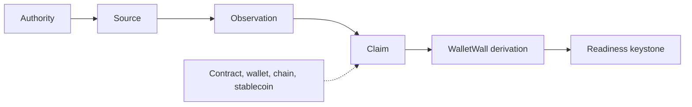

# WalletWall canvas design system

The visual and interaction rules of the WalletWall canvas (`plugin/com.github.copilot/extensions/walletwall-evidence-explorer/`). The canvas contract (what it may and may not show or do) is in `canvas/README.md`; this document is about how it looks and moves, and why.

The design goal is *the WalletWall Coinstellation as an evidence instrument*, drawn like a matte, printed technical plate: one warm stage where every source, observation, claim, WalletWall derivation and the readiness keystone is a node of one circular family; charcoal and deep slate for structure; terracotta for the WalletWall wordmark and for focus; umber for drafted lines; and states drawn with rings, lines, fills and words, never colour alone. Nothing visible is white. The Wall is a projection of the authoritative view the explorer builds from the WalletWall MCP results; it creates, strengthens or replaces no evidence state.

## Brand sources

Nothing is redrawn. Every value or asset comes from a WalletWall brand source; `canvas/brand/brand-sources.json` records the repository, commit, path, SHA-256 and the exact transformation of each file, and `scripts/gen-canvas-brand.ts` refuses to embed a file whose hash differs.

| What | Source | Shipped as |
| --- | --- | --- |
| Colour tokens | `Wallet-Wall/walletwall-audio-visual-docs` `contracts/walletwall-brand.json` (values copied from the WalletWall app's canonical `src/index.css` `:root` and `src/theme.js`, drift-checked there) | CSS custom properties in `styles.mjs` |
| Mark | `Wallet-Wall/walletwall-audio-visual-docs` `assets/brand/walletwall-brick-wallet.png` (the reviewed brick-wallet mark) | `canvas/brand/walletwall-brick-wallet-96.png`, uniformly downscaled, embedded as a `data:` URI |
| Guide | `Wallet-Wall/walletwall-audio-visual-docs` `blender/proof/reference/inspect.png`, `perch.png` (WalletWallaby renders) | `canvas/brand/walletwallaby-*.png`, cropped to the character and downscaled |
| Fonts | The WalletWall app's `:root` (`--font-display` Sora, `--font-ui` Manrope, `--font-mono` IBM Plex Mono) and its `package-lock.json` (`@fontsource-variable/sora` 5.2.8, `@fontsource-variable/manrope` 5.2.8, `@fontsource/ibm-plex-mono` 5.2.7) | The packages' latin `woff2` files, unmodified, in `canvas/brand/fonts/`, embedded as `data:` URIs |

The cream horizontal "Wallet Wall" lockup is not used. The mark is never recoloured, stretched or redrawn; the brand pack has no vector master, so the canvas uses the raster mark.

Fonts are used under the SIL Open Font License 1.1; the license texts ship in `plugin/THIRD_PARTY_NOTICES.md`. The WalletWall mark and WalletWallaby are WalletWall brand assets: the software license grants no right to them (`TRADEMARKS.md`).

### Offline by construction

The page makes no font, image, stylesheet or script request. Its CSP is `default-src 'none'`, scripts and styles by nonce, `connect-src 'self'`, and `font-src data:` / `img-src data:` for the embedded brand assets only. There is no `@import`, no CDN and no remote image. Tests: `packages/mcp/test/canvas/design.test.ts` (asset hashes, `data:`-only sources) and `explorer.test.ts` (CSP).

## Colour tokens

Surfaces separate by flat fill and value, not by hue alone and never by a shadow: each pair of neighbouring large surfaces is at least 1.2:1 in relative luminance (tested), and the rail's folded rows step 1.1:1 from the rail.

| Token | Value | Role on the canvas |
| --- | --- | --- |
| `--ww-page` | `#DDD3C0` (warm stone with 30 % stone) | The workspace |
| `--ww-stage` | `#B8AD9C` (warm stone deepened with stone-low and deep slate) | The Coinstellation stage; the list (another lens on the same pieces) |
| `--ww-rail` / `--ww-row` | `#D4BD98` / `#CDB38C` (tan parchment; the rail with 25 % stone-low) | The detail rail and sheet, the readiness and About panels / the rail's folded-section headers |
| `--ww-shell` | `#221F1C` (charcoal deepened toward the ink) | The summary header, so the terracotta wordmark reaches 3.4:1 |
| `--ww-charcoal` | `#2B2B2E` | The control bar, menus, tooltips, the readiness keystone |
| `--ww-deep-slate` | `#3A3D41` | The Wallprint band |
| `--ww-accent` | `#BF4E32` (terracotta) | The WalletWall wordmark, the Wallmark's fill, the header's rule |
| `--ww-accent-dark` | `#8B3120` | The detail head (what is in focus), the active mode, the selection trace on a ring, the guide's pointer, focus outlines |
| `--ww-brick-low` | `#76281D` (from the Coinstellation's brick material) | Conflict and staleness rings, the selected ring, the selected or traced path, attention chips, eyebrows |
| `--ww-node` / `--ww-node-quiet` | `#DDCBA8` / `#CBBCA2` | Piece faces: parchment, then a quieter stone (sources, derivation, subjects) |
| `--ww-label` | `#E2D2B2` | State chips and the Copy control |
| `--ww-umber` / `--ww-umber-deep` | `#674739` / `#4F3C35` (accent-dark and stone-low mixed half and half, deepened with 50 % / 70 % charcoal) | Connectors, rings, glyphs, chip edges, hairline seams; secondary labels |
| `--ww-stone-low` | `#b99568` | The filled half of a PARTIAL piece |
| `--ww-ink` / `--ww-muted-text` | `rgba(30,26,20,0.9)` / `0.7` | Text on light surfaces |

The canonical app tokens (`--ww-bg`, `--ww-surface`, `--ww-cream`, `--ww-charcoal`, `--ww-accent`, `--ww-accent-dark`) keep their values. Cream, paper and mortar (`--ww-cream`, `--ww-bg`, `--ww-surface`, `--ww-mortar`) paint no surface, piece, chip or button; cream remains the text colour on dark surfaces and the Trace glint. No neon, purple or generic green is introduced, there is no additional hue, and no colour means good or bad: terracotta is the wordmark and focus, never approval or alarm; umber is material depth, never a state.

**No white.** No visible panel, node, chip, button, tooltip, row or sheet is `#fff` or reads as white (tested on the tokens, audited in Chromium on every visible element): every light colour is cream, parchment, sand or warm stone, with OKLab lightness below 0.90 and, from 0.86 up, chroma of at least 0.02.

## Typography

| Role | Family | Use |
| --- | --- | --- |
| Display | Sora Variable (600) | The WalletWall wordmark; section titles: The Wall, Wallprint, the detail title (Wallmark or the focused piece), Readiness |
| UI | Manrope Variable (500 to 700) | Body, labels, piece names, controls, the asset context (`USDC · chain 1`), guide text, status text |
| Mono | IBM Plex Mono (400, 500) | Exact machine values only: addresses, hashes, IDs, block numbers, reason codes, criterion IDs |

**The wordmark.** The product name in the header is the wordmark: Sora 600, 24 px, in `--ww-accent` (the canonical terracotta, tested to resolve to `#BF4E32`), at every width, the phone included. It is the only text painted in the accent; ordinary prose that names WalletWall is not recoloured. The asset context beside it is Manrope 700 at 15 px with the chain in Manrope at 13 px, so the symbol never outweighs the name. On the deepened shell the wordmark is 3.4:1, large text. The brick-wallet mark beside it is never recoloured, redrawn, stretched or filtered.

Eyebrows: 10.5 px, 700, 0.16 em tracking, uppercase, `--ww-brick-low` on light surfaces and `--ww-stone` on dark ones. Graph micro-labels (the keystone's word): 9 px, 700, 0.18 em. Piece labels on The Wall: 11.5 px, 700, with a stage-coloured knockout so a connector never runs through a word; state chips: 8.5 px, 700. Weights stay inside the embedded faces: Sora 600, Manrope 500 to 700, IBM Plex Mono 400 and 500, so nothing is synthesised. No family other than the three is used, and none is fetched.

## Geometry

Radii: 2 px for panels, controls and chips (`--ww-radius-panel`, `--ww-radius-badge`); no pills. Lines are hairlines: 1 px seams and dividers, borders at most 2 px (the header's terracotta rule, the readiness criteria's attention mark, the Why? ladder). Full-perimeter borders are rare: surfaces separate by value and rows by dividers, so the first view at 1280 px has six boxes (header, control bar, detail rail and its head, the rail's folded rows, Wallprint), down from fourteen, and nests at most two deep. A faint 28 px, 1 px grid sits under The Wall only, at 1.09:1 against the stage: felt, not read.

## Material

Matte and drafted, like a printed technical plate; never a SaaS card, a bevel or a game token.

- **Fills are flat.** No gradient on a piece, chip, control or panel; the only gradients draw the 1 px grid and the phone strip's edge fade.
- **One line family.** An umber hairline seam (`--ww-seam`, 1.6 to 1.8:1) round the stage, rail and light panels; a fainter umber divider (`--ww-cut`) between rows; a near-black 1 px seam (`--ww-cut-dark`) between control segments, menu items and Wallprint items; the grid fainter still.
- **No depth effects.** No drop shadow, inset shadow, text shadow, filter, bevel or pressed effect anywhere (tested). The only highlight is the etch beside each connector: the same path in cream at 0.12, offset 0.4 and 0.6 units (under 1 CSS px at every gated size), so a connector reads as one mark cut into the stage, not two strokes.
- **Chips** are stamped tags: a flat `--ww-label` face, a 1 px umber edge (a dashed rust edge and rust words for attention), a 2 px corner, 20 px tall. One component everywhere.
- **Controls** are printed instrumentation: a flat charcoal bar, 1 px seams between segments, the active mode a flat terracotta-dark fill; nothing lifts, presses or moves.
- **Copy** is a small stamped control in the chip material (Copy on hover or focus, Copied on success).
- **Interaction** changes the drawing, not depth: under a pointer a piece's ring firms slightly; selection weights and colours the ring; connectors on the selected path turn rust.

## The Wall

The centre of the panel, drawn as a Coinstellation. The node language is adapted from `Wallet-Wall/walletwall-coinstellation` (commit `3ff0942`): compact circular nodes, straight connectors with a small arrow, a selection ring, highlighting of the directly connected nodes and muting of the rest, an anomaly-style ring for conflict, and keyboard operation (Tab, Enter, Space, Escape). Its demo taxonomy (wallet, token, defi, nft, counterparty), demo data, five node colours and fixed 780 by 560 frame are not used; the React component is not shipped. The renderer was ported to the canvas's own string SVG and page script, which keeps the plugin free of a build step, a framework and any change to the CSP.

**Layers.** `explorer.mjs` builds the authoritative view (the bundle joined with the MCP results). `coinstellation-model.mjs` projects it into a visual model, `buildCoinstellation(view, presentation)`: nodes and edges only from relationships the bundle or the MCP results state, every evaluated state copied verbatim, and Trace emphasis from `trace_provenance` only; it reads no clock, randomness, storage or network and never mutates the view. `wall.mjs` draws that model; `client.mjs` adds local interaction. Subjects are grouped only by exactly equal values, never by fuzzy matching.

### Node family

One circular node for every piece; the readiness keystone is the one other shape (and the Wallmark stays circular, only larger). The canonical primitive is a flat face and one umber ring, 1 unit wide (1.2 for ESTABLISHED), with a small engraved glyph about a third of the diameter (glyph scale r / 22, a constant 1.25-unit line) and nothing else: no rim, lip, shadow, gradient or hatch. A state adds at most one ring, close outside the first (3.5 units), so an ordinary piece shows one ring, or two with a state, and a conflict stays within 1.2 times an ordinary piece. Kinds differ by the glyph, the label, the chip and the ring's weight, never by silhouette.

| Piece | Glyph and treatment | From |
| --- | --- | --- |
| Wallmark | terracotta node with a rust ring and a stone glyph, the largest node | The `ASSET_IDENTITY` claim and its evaluation |
| Assertion | parchment node, brick glyph, state chip | Every other claim |
| Readiness keystone | charcoal keystone, its classification and support as chips | `assess_vault_readiness` (`view.readiness`), never recomputed |
| Authority | parchment node, column glyph | `source.authorityId` or the identity's `issuerAuthorityId`; never a transport |
| Source / observation | quiet node, signal glyph / parchment node, measurement glyph | The bundle |
| WalletWall derivation | quiet node, merge glyph, "WalletWall rule" | `derivations` |
| Conflict | rust node, fracture glyph, one fractured ring that breathes in opacity | An evaluation's `conflictsWith` |
| Missing piece / snapshot slot | open dashed node | A reference the bundle lacks / always next to a keystone; nothing fills it |
| Chain, contract, wallet, stablecoin | quiet nodes with a link, document, wallet or coin glyph | The claims' exact subject values |

Labels are short (Issuer, Chain state, Issuer source, Provider, Identity obs, Balance obs, Price obs, Balance, Price, Wallmark, Readiness, Wallet, Contract, Chain) and at most two lines: label and chip. A piece never shows an assertion ID, a full or shortened address, a hash or an authority ID; the exact value is in its accessible name, its tooltip, the detail surface and Copy.

### Layout

Two deterministic coordinate sets from the topology alone, computed on the server: **wide** (reads left to right, for desktop and landscape) and **tall** (top to bottom, for phones and portrait tablets). Pieces are ranked by what they rest on; within a rank they are ordered to reduce crossings (barycentric sweeps from several fixed starting orders, then a local search on the real geometry that also moves one-to-one source, observation and claim chains together); a crowded rank in the tall layout is staggered in two offset rows; subjects sit in the free room from the claims' rank on and stay near what they belong to. A connector that would pass through a piece or its label bends around it. The frame takes the drawing's own proportions with about 8 % margin, so the whole wall fits without a blank band. No simulation runs, here or in the page; the same view always gives the same picture (tested). For `conflicting-balances` the wide layout has 1 crossing (3 before) and the tall one 5 (11 before).

### Interaction

- **Overview** shows the whole state, calm: nothing is muted until someone acts. The dominant story (a fixed precedence over returned states: conflict, then an invariant violation on a focal claim, then staleness, then a weak focal claim, then an established Wallmark) gets its emphasis: the conflict path in rust, a stale piece receding inside a dashed ring, or the Wallmark-to-readiness path.
- **Hover or keyboard focus** previews a piece: its direct connections stay, the rest steps back a little, and one tooltip appears (after 350 ms on hover, at once on focus).
- **Selecting** a claim is the shared assertion selection: the page shows it at once, then `POST /select` makes it the explorer's `selectedId`, the same state the agent's `select_assertion` sets, and the server re-renders through the events stream. Selecting any other piece is **visual focus** only: its connections and facts are shown, and it never becomes an assertion selection or a provenance request. The detail head says which it is. Either way the focused piece's own ring becomes heavier (2 units) and rust, with a terracotta-dark trace lying on that ring that breathes in opacity, so selection adds no ring and grows the piece by about 4 %; the piece and its direct connections stay; everything else drops to 45 %, with labels kept readable. A conflict marker only joins two claims, so selecting either side keeps the marker, the other claim and both conflict connectors at full strength. Escape or a tap on empty space returns to the whole wall.
- **Trace** keeps every piece where it is and emphasises the provenance `trace_provenance` returned for the selected assertion; everything else recedes, the traced connectors are drawn solid and heavier, and a glint pulses along them from the sources toward the claim. There is no separate lineage diagram.
- **Zoom** (the More menu, `+` and `−` keys, pinch) narrows the view box inside the same frame; Fit returns to the whole wall. A mouse can drag a piece to pin it; Reset layout returns it.

## Readiness

The six `assess_vault_readiness` criteria are a checklist beside the keystone (✓ in place, ! not met or indeterminate, ? not recognised). The keystone seats only when the engine's classification is `CRITERIA_MET`; otherwise it is lifted off a dashed seat. The canvas does not decide this; it draws the returned classification.

## State visualisation

Never colour alone: every state has at least two encodings, and all of them stay under reduced motion.

| State | On The Wall |
| --- | --- |
| `ESTABLISHED` | solid node with a firmer, deeper ring |
| `SUPPORTED` | solid node with the lighter ring: a quieter stamp |
| `PARTIAL` | half-filled node |
| `CONFLICTING` | rust ring with one fractured rust ring outside it, broken rust connector, a conflict node between the claims, the chip |
| `STALE` | worn, receded node inside one dotted rust ring, the chip |
| `SUPERSEDED` | faint node with a historical outline behind it, a dotted connector to its replacement |
| `UNKNOWN` / `NOT_ESTABLISHED` / no evaluation | open dashed node and the chip: an empty slot, not a zero or false |
| `NO_RESULT` observation | open dashed node, "no result" chip |

## Motion

| When | What moves |
| --- | --- |
| The bundle changes | The pieces settle once into their places (14 frames, about 240 ms); the keystone's chips resolve last |
| Selection, hover, Trace, the sheet | Opacity, ring and connector transitions of 140 to 280 ms |
| Always, while relevant | Restrained loops on opacity (and the guide's 2 px transform) only, with no pulsing scale: the conflict ring breathes, the selection trace on the ring breathes, the guide's pointer breathes, a stale node recedes slowly, a light glint pulses along the traced connectors from the sources toward the claim (the connector itself stays solid), WalletWallaby idles |

Nothing drifts after the settle: base positions are fixed until someone drags a piece. Reduced motion (the system setting or **Reduce motion**) stops every loop and transition; the static rings, lines, fills and chips carry the same meaning.

## Wallmark

WalletWall's canonical stablecoin identity record: the identity claim, drawn as the largest node in terracotta with the brick glyph, its symbol as presented and the support state the engine returned. Its detail holds the full contract address, the issuer or protocol authority and the rest. The words "verified" and "safe" are never used for a Wallmark.

## Wallprint

A flat deep-slate band under The Wall, titled in Sora with stone eyebrows and its items divided by 1 px near-black seams: Wallmark, Readiness, Freshness (the Wallmark's), Conflicts, Sources, Chain, Wallet, and Invariants when there are violations. Each item is one label and one value (a returned chip or a count); each one with a piece behind it focuses that piece. It is not a score and computes no combined state.

## WalletWallaby

The optional guide, using the WalletWallaby renders, on the stage beside the controls (under The Wall on a phone), so it never covers a piece. Every cue is about one concrete piece and marks it with four short radial ticks across its ring (deliberately unlike the dotted ring that means STALE, and adding no ring of its own); the cue text is printed on the stage behind one umber hairline, not in a bubble: on load, the dominant story's piece (the conflict in `conflicting-balances`, the stale Wallmark in `stale-identity`, the Wallmark and the keystone it feeds in `usdc-established`), at most 20 words; on selection, that piece, at most 24 words. Cues repeat returned states only. The one control reads exactly **Hide Guide** while the guide is on and **Show Guide** while it is off. It is never required to operate the panel. WalletWallrus is the builder identity and does not appear on the canvas.

## Observed, Replay, Scenario

| Lens | Status |
| --- | --- |
| Observed | Active: the only lens with complete semantics |
| Replay | Disabled: "Replay — requires immutable snapshots." |
| Scenario | Disabled: "Scenario — simulation engine not yet enabled." |

## Receipt and QR (reserved)

The Receipt area has **Copy receipt**, **Verify** and **QR**, all disabled with "Requires immutable snapshot." visible on screen, and an empty 96 px QR slot. On a phone it folds to one row ("Receipt · Requires immutable snapshot.") without the QR slot. When immutable snapshots exist, the QR code will locate a verifiable snapshot receipt; it will never encode a wallet address, a local URL, a Copilot session, a key or the query. No receipt, snapshot identifier or QR code is generated today.

## Accessibility

- Every piece is a focusable `role="button"` with a full accessible name (type, label or full address, assertion ID, chain, support, freshness and readiness in words) and a touch target of at least 44 px that never overlaps another.
- The Wall has two text alternatives: the list (search, filter chips, one row per piece with its state and type) and "The Wall as a list" (a table of every piece, its state, the selected assertion and what it rests on), and a legend.
- Focus is always visible. Tooltips never hold the only copy of a fact; disabled controls state their reason as visible text.
- Status changes are announced in a polite live region; copying announces the result without repeating the address.
- Contrast: body text at least 4.5:1 on its surface (4.54:1 for muted text on the rail), piece labels 6.4:1 on the stage, controls and state indicators at least 3:1, connectors 3.7:1, the selected and traced path and conflict connectors 4.5:1 (measured in Chromium on the stage colour). The wordmark is 3.4:1 at 24 px (large text). The decorative grid stays at 1.09:1, and connectors stand out from the stage about 29 times more than the grid does.
- Touch: on a coarse pointer, at any width, the toolbar, menu items, Back to Overview, folded sections and the "Why?" toggles take at least 44 by 44 CSS px; the phone sheet's grip draws a 24 px bar and takes 44 px, the extra reaching invisibly over the sheet's head.

## Responsive behaviour

The page never scrolls horizontally and nothing is hidden to prevent it (no `overflow-x: hidden`). Three compositions:

| Width | Composition |
| --- | --- |
| 1024 px and wider | The summary header; The Wall (about 70 % of the width, wide layout) and the detail rail (280 to 340 px) side by side, the rail sticky; the Wallprint band beneath, then readiness, the list, the criteria, the legend, the Receipt row and the text version. |
| 768 to 1023 px | The summary header with the critical state strip; The Wall about two thirds of the width (tall layout when upright) with the guide above it and the detail rail beside it; Wallprint and readiness beneath. |
| Below 768 px | The summary header (mark, wordmark and asset; the lens badge waits in About) and strip, then The Wall as the stage (tall layout), the guide under it, then Wallprint, readiness and the list; the detail is a bottom sheet. |

**State strip.** Below 1024 px: Wallmark, freshness and readiness exactly as returned, led by a conflict chip when the engine reported one, and an invariant chip only when there are violations. It scrolls sideways inside itself on a phone. Each chip leads to its piece.

**Controls.** One charcoal bar on the stage's top edge: Overview, Trace, Fit, Hide Guide and More on wider panels; zoom in, Fit and More on a phone. More holds Trace and the guide (on a phone), zoom in and out, Reset layout, Reduce motion, List view and About this panel (the boundary note, versions, the lenses that are not live yet with their reasons, and invariant violations). In Trace on a phone, where Overview sits in More, "Back to Overview" appears on the stage; wider panels keep Overview in the bar.

**Detail.** At most six facts first (support, freshness, finality, authority, conflicts when there are any, and the limitation count), with "Why?" beside each state; Provenance, Details (the exact subject and value with Copy, the authority class, corroboration, supersession, policy), Limitations and Sources one step away. On a phone it is a bottom sheet: peek (the piece, its state and one line of meaning), half and full; a grip, a swipe, the summary or More change state, Escape folds it one step. Only the sheet stays on screen while scrolling.

**Copy.** Copy and Copy chain + address appear on hover or keyboard focus without moving anything, and are always there on touch; Copied shows for 1.5 s; the copied text is exactly the full value shown.

**Touch.** Tap to select or focus, tap empty space to clear, pinch to zoom, drag to pan once zoomed. Nothing depends on a long press; a finger never drags a piece.

**Turning the device.** The page recomputes the composition when the panel turns or resizes. A phone on its side gets the wide layout and a right-hand detail panel of about 40 %.

Scrollbars that remain are narrow: a track the colour of the surface it scrolls (page or rail) with a deep-slate thumb that turns terracotta while engaged. The page's favicon is the WalletWall brick-wallet mark, embedded, so no icon is fetched.

## Rendering stack

SVG for The Wall, DOM for text, controls and accessibility, and a deterministic layout in `coinstellation-model.mjs` instead of a graphics library or a framework. The reference Coinstellation is a React component; porting its renderer to plain SVG strings keeps the plugin deterministic, dependency-free and inside the existing nonce CSP. Optional browser features (View Transitions, anchor positioning) are not needed: CSS transitions settle within 280 ms and the tooltip is positioned by the page script, so nothing depends on a feature the host WebView may lack. Three.js and WebGL are not used.

## Deferred

Immutable snapshots, Merkle roots, receipts, QR verification, historical replay data, a simulation engine, paid or live data, hosted runtimes and bring-your-own providers. The affordances above reserve their place; none of them is implemented.
