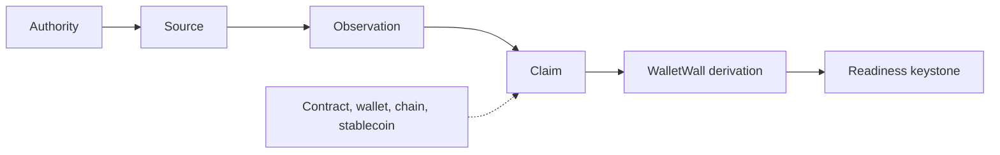

# WalletWall canvas design system

The visual and interaction rules of the WalletWall canvas (`plugin/com.github.copilot/extensions/walletwall-evidence-explorer/`). The canvas contract (what it may and may not show or do) is in `canvas/README.md`; this document is about how it looks and moves, and why.

The design goal is *the WalletWall Coinstellation as an evidence instrument*, drawn like a matte, printed technical plate: one warm stage where every source, observation, claim, WalletWall derivation and the readiness keystone is a node of one circular family; charcoal and deep slate for structure; terracotta for the WalletWall wordmark and for focus; umber for drafted lines; and states drawn with rings, lines, fills and words, never colour alone. Nothing visible is white. The Wall is a projection of the authoritative view the explorer builds from the WalletWall MCP results; it creates, strengthens or replaces no evidence state.

## Brand sources

Nothing is redrawn. Every value or asset comes from a WalletWall brand source; `canvas/brand/brand-sources.json` records the repository, commit, path, SHA-256 and the exact transformation of each file, and `scripts/gen-canvas-brand.ts` refuses to embed a file whose hash differs.

| What | Source | Shipped as |
| --- | --- | --- |
| Colour tokens | `Wallet-Wall/walletwall-audio-visual-docs` `contracts/walletwall-brand.json` (values copied from the WalletWall app's canonical `src/index.css` `:root` and `src/theme.js`, drift-checked there) | CSS custom properties in `styles.mjs` |
| Mark | `Wallet-Wall/walletwall-audio-visual-docs` `assets/brand/walletwall-brick-wallet.png` (the reviewed brick-wallet mark) | `canvas/brand/walletwall-brick-wallet-96.png`, uniformly downscaled, embedded as a `data:` URI |
| Guide | `Wallet-Wall/walletwall-audio-visual-docs` `blender/proof/reference/inspect.png`, `perch.png` (WalletWallaby renders) | `canvas/brand/walletwallaby-*.png`, cropped to the character and downscaled |
| Fonts | The WalletWall app's `:root` (`--font-display` Sora, `--font-ui` Manrope, `--font-mono` IBM Plex Mono) and its `package-lock.json` (`@fontsource-variable/sora` 5.2.8, `@fontsource-variable/manrope` 5.2.8, `@fontsource/ibm-plex-mono` 5.2.7) | The packages' latin `woff2` files, unmodified, in `canvas/brand/fonts/`, embedded as `data:` URIs |

The cream horizontal "Wallet Wall" lockup is not used. The mark is never recoloured, stretched or redrawn; the brand pack has no vector master, so the canvas uses the raster mark.

Fonts are used under the SIL Open Font License 1.1; the license texts ship in `plugin/THIRD_PARTY_NOTICES.md`. The WalletWall mark and WalletWallaby are WalletWall brand assets: the software license grants no right to them (`TRADEMARKS.md`).

### Offline by construction

The page makes no font, image, stylesheet or script request. Its CSP is `default-src 'none'`, scripts and styles by nonce, `connect-src 'self'`, and `font-src data:` / `img-src data:` for the embedded brand assets only. There is no `@import`, no CDN and no remote image. Tests: `packages/mcp/test/canvas/design.test.ts` (asset hashes, `data:`-only sources) and `explorer.test.ts` (CSP).

## Colour tokens

Surfaces separate by flat fill and value, not by hue alone and never by a shadow: each pair of neighbouring large surfaces is at least 1.2:1 in relative luminance (tested). The rail is one flat sheet: its folded sections are rows on the same surface, divided by hairlines, with no second fill.

| Token | Value | Role on the canvas |
| --- | --- | --- |
| `--ww-page` | `#DDD3C0` (warm stone with 30 % stone) | The workspace |
| `--ww-stage` | `#B8AD9C` (warm stone deepened with stone-low and deep slate) | The Coinstellation stage; the list (another lens on the same pieces) |
| `--ww-rail` | `#D4BD98` (tan parchment) | The detail rail and sheet, the readiness and About panels |
| `--ww-shell` | `#221F1C` (charcoal deepened toward the ink) | The summary header, so the terracotta wordmark reaches 3.4:1 |
| `--ww-charcoal` | `#2B2B2E` | The control bar, menus, tooltips, the readiness keystone |
| `--ww-deep-slate` | `#3A3D41` | The Wallprint band |
| `--ww-accent` | `#BF4E32` (terracotta) | The WalletWall wordmark, the Wallmark's fill, the header's rule |
| `--ww-accent-dark` | `#8B3120` | The detail head (what is in focus), the active mode, the selection trace on a ring, the guide's pointer, focus outlines |
| `--ww-brick-low` | `#76281D` (from the Coinstellation's brick material) | Conflict and staleness rings, the selected ring, the selected or traced path, attention chips, eyebrows |
| `--ww-node` / `--ww-node-quiet` | `#DDCBA8` / `#CBBCA2` | Piece faces: parchment, then a quieter stone (sources, derivation, subjects) |
| `--ww-label` | `#E2D2B2` | State chips and the Copy control |
| `--ww-umber` / `--ww-umber-deep` | `#674739` / `#4F3C35` (accent-dark and stone-low mixed half and half, deepened with 50 % / 70 % charcoal) | Connectors, rings, glyphs, chip edges, hairline seams; secondary labels |
| `--ww-stone-low` | `#b99568` | The filled half of a PARTIAL piece |
| `--ww-ink` / `--ww-muted-text` | `rgba(30,26,20,0.9)` / `0.7` | Text on light surfaces |

The canonical app tokens (`--ww-bg`, `--ww-surface`, `--ww-cream`, `--ww-charcoal`, `--ww-accent`, `--ww-accent-dark`) keep their values. Cream, paper and mortar (`--ww-cream`, `--ww-bg`, `--ww-surface`, `--ww-mortar`) paint no surface, piece, chip or button; cream remains the text colour on dark surfaces and the Trace glint. No neon, purple or generic green is introduced, there is no additional hue, and no colour means good or bad: terracotta is the wordmark and focus, never approval or alarm; umber is material depth, never a state.

**No white.** No visible panel, node, chip, button, tooltip, row or sheet is `#fff` or reads as white (tested on the tokens, audited in Chromium on every visible element): every light colour is cream, parchment, sand or warm stone, with OKLab lightness below 0.90 and, from 0.86 up, chroma of at least 0.02.

## Typography

| Role | Family | Use |
| --- | --- | --- |
| Display | Sora Variable (600) | The WalletWall wordmark; section titles: The Wall, Wallprint, the detail title (Wallmark or the focused piece), Readiness |
| UI | Manrope Variable (500 to 700) | Body, labels, piece names, controls, the asset context (`USDC · chain 1`), guide text, status text |
| Mono | IBM Plex Mono (400, 500) | Exact machine values only: addresses, hashes, IDs, block numbers, reason codes, criterion IDs |

**The wordmark.** The product name in the header is the wordmark: Sora 600, 24 px, in `--ww-accent` (the canonical terracotta, tested to resolve to `#BF4E32`), at every width, the phone included. It is the only text painted in the accent; ordinary prose that names WalletWall is not recoloured. The asset context beside it is Manrope 700 at 15 px with the chain in Manrope at 13 px, so the symbol never outweighs the name. On the deepened shell the wordmark is 3.4:1, large text. The brick-wallet mark beside it is never recoloured, redrawn, stretched or filtered.

Eyebrows: 10.5 px, 700, 0.16 em tracking, uppercase, `--ww-brick-low` on light surfaces and `--ww-stone` on dark ones. Graph micro-labels (the keystone's word): 9 px, 700, 0.18 em. On The Wall: anchor labels 11.5 px Manrope 700, fact labels 11 px 600, context labels 11 px 500 in deep slate (4.9:1), each with a stage-coloured knockout; state annotations 9.5 px Manrope 700, uppercase, 0.08 em, in umber or rust; exact identifiers stay off the plate (IBM Plex Mono in the detail rail). Sora is for display headings only. Weights stay inside the embedded faces: Sora 600, Manrope 500 to 700, IBM Plex Mono 400 and 500, so nothing is synthesised. No family other than the three is used, and none is fetched.

## Geometry

Radii: 2 px for panels, controls and chips (`--ww-radius-panel`, `--ww-radius-badge`); no pills. Lines are hairlines: 1 px seams and dividers, borders at most 2 px (the header's terracotta rule, the readiness criteria's attention mark, the Why? ladder). Full-perimeter borders are rare: surfaces separate by value and rows by dividers, so the first view at 1280 px has five boxes (header, control bar, detail rail and its head, Wallprint), down from fourteen, and nests at most two deep. Under The Wall only, a sparse drafting sheet grid: 1 px lines every 64 px at 1.07:1 against the stage, and no minor grid. The plate's own construction carries the structure: faint dash-dot centrelines on the axes the composition is built on and four crop marks at the frame's corners (none on a phone).

## Material

Matte and drafted, like a printed technical plate; never a SaaS card, a bevel or a game token.

- **Fills are flat.** No gradient on a piece, chip, control or panel; the only gradients draw the sheet grid and the phone strip's edge fade.
- **One line family.** An umber hairline seam (`--ww-seam`, 1.6 to 1.8:1) round the stage, rail and light panels; a fainter umber divider (`--ww-cut`) between rows; a near-black 1 px seam (`--ww-cut-dark`) between control segments, menu items and Wallprint items; the grid fainter still.
- **No depth effects.** No drop shadow, inset shadow, text shadow, filter, bevel or pressed effect anywhere (tested). The only highlight is the etch beside each connector: the same path in cream at 0.12, offset 0.4 and 0.6 units (under 1 CSS px at every gated size), so a connector reads as one mark cut into the stage, not two strokes.
- **Chips** are stamped tags for the software around the plate (the detail rail, Wallprint, the header strip, the list): a flat `--ww-label` face, a 1 px umber edge (a dashed rust edge and rust words for attention), a 2 px corner, 20 px tall. One component everywhere off the plate; on The Wall states are written, never boxed.
- **Controls** are printed instrumentation: a flat charcoal bar, 1 px seams between segments, the active mode a flat terracotta-dark fill; nothing lifts, presses or moves.
- **Copy** is a small stamped control in the chip material (Copy on hover or focus, Copied on success).
- **Interaction** changes the drawing, not depth: under a pointer an anchor's ring firms slightly and a light mark's ring appears; selection weights and colours the ring; connectors on the selected path turn rust.

## The Wall

The centre of the panel, drawn as a Coinstellation. The node language is adapted from `Wallet-Wall/walletwall-coinstellation` (commit `3ff0942`): compact circular nodes, straight connectors with a small arrow, a selection ring, highlighting of the directly connected nodes and muting of the rest, an anomaly-style ring for conflict, and keyboard operation (Tab, Enter, Space, Escape). Its demo taxonomy (wallet, token, defi, nft, counterparty), demo data, five node colours and fixed 780 by 560 frame are not used; the React component is not shipped. The renderer was ported to the canvas's own string SVG and page script, which keeps the plugin free of a build step, a framework and any change to the CSP.

**Layers.** `explorer.mjs` builds the authoritative view (the bundle joined with the MCP results). `coinstellation-model.mjs` projects it into a visual model, `buildCoinstellation(view, presentation)`: nodes and edges only from relationships the bundle or the MCP results state, every evaluated state copied verbatim, and Trace emphasis from `trace_provenance` only; it reads no clock, randomness, storage or network and never mutates the view. `wall.mjs` draws that model; `client.mjs` adds local interaction. Subjects are grouped only by exactly equal values, never by fuzzy matching.

### Grammar: a technical plate

The stage is a modern technical plate inside modern software: the header, toolbar, detail rail and Wallprint are application UI; the centre is an analytical drawing and does not borrow the controls' grammar. Not every entity is a node object. Geometry follows meaning in three classes (`TIER` in the model):

| Class | Pieces | Drawn as |
| --- | --- | --- |
| Anchor | Wallmark, claims, a conflict, the readiness keystone | the only node objects: a flat disc and one umber ring (1 unit, 1.2 for ESTABLISHED) with a small engraved glyph; the Wallmark a terracotta seal with a fine stone line inside the disc; a conflict a rust ring broken at both sides and split by a terracotta seam; the keystone its own shape |
| Fact | observations, WalletWall's rule, a missing piece | light drafting marks: a registration cross, a summing junction (a ring with a cross), an open dashed ring |
| Context | authorities, sources, chain, contract, wallet, stablecoin, the snapshot slot | an index mark (a small solid square, a coin outline, a dashed square) or a small glyph (columns, link, document, wallet) and the name, no enclosure; marks at about 70 % |

In the canonical fixtures 21 to 26 % of the pieces are node objects (all of them before) and 35 to 37 % carry an illustrative glyph (95 % before). A fact or context piece's ring is drawn only under hover, keyboard focus or selection (progressive emphasis): the ring appears, the label strengthens and its connections, references included, come up to full strength; at rest the plate stays sparse. Every piece keeps a touch target of at least 52 units (about 45 CSS px on a phone) however small its mark.

States are drafting notation, written under the label in small capitals: `WALLMARK · USDC` / `ESTABLISHED`, `BALANCE` / `CONFLICTING` (rust where the state asks for attention). The keystone carries two lines: its classification, then a small `support` key and the claim's support state. No state is boxed on the plate.

| Piece | Mark | From |
| --- | --- | --- |
| Wallmark | terracotta seal, brick glyph, the largest disc | The `ASSET_IDENTITY` claim and its evaluation |
| Assertion | parchment disc, ledger glyph, written state | Every other claim |
| Readiness keystone | charcoal keystone at the end of the evaluation axis; classification and support written beneath | `assess_vault_readiness` (`view.readiness`), never recomputed |
| Conflict | broken rust ring split by a terracotta seam, breathing in opacity | An evaluation's `conflictsWith` |
| Observation | registration cross | The bundle |
| WalletWall derivation | summing junction, "WalletWall rule" | `derivations` |
| Missing piece / snapshot slot | open dashed ring / dashed square, written MISSING or RESERVED | A reference the bundle lacks / always next to a keystone; nothing fills it |
| Authority | small column glyph | `source.authorityId` or the identity's `issuerAuthorityId`; never a transport |
| Source | small solid index square | The bundle |
| Chain, contract, wallet / stablecoin | small link, document or wallet glyph / coin outline | The claims' exact subject values |

Labels are short (Issuer, Chain state, Issuer source, Provider, Identity obs, Balance obs, Price obs, Balance, Price, Wallmark, Readiness, Wallet, Contract, Chain) and at most two lines: label and state. A piece never shows an assertion ID, a full or shortened address, a hash or an authority ID; the exact value is in its accessible name, its tooltip, the detail surface and Copy.

### Line hierarchy

Line weight says which relationships matter before any label is read (`LINE_CLASS` in the model; measured at 1280 px, weight = contrast excess times CSS width):

| Class | Relationships | Drawn | At 1280 px |
| --- | --- | --- | --- |
| Active Trace | the provenance `trace_provenance` returned | terracotta-dark, 2.2 units, solid, with a glint | 1.9 px, weight 5.2 |
| Primary evidence | observation to claim, claim to rule, rule to claim | umber at 0.92, 1.2 units, solid, arrow; the dominant story deep umber, 1.5 | 1.1 px, weight 2.4 to 3.0 |
| Secondary | source and authority leaders, missing inputs, supersession | umber at 0.58, 0.8 units | 0.7 px, weight 0.7 |
| Reference | subjects and names | charcoal at 0.3, 0.7 units | 0.6 px, weight 0.4 |
| Construction | the snapshot reservation | charcoal at 0.26, 0.6 units, dashed | 0.5 px, weight 0.3 |
| Grid | the sheet | 1 px at 1.07:1 | weight 0.07 |

The conflict connection is its own mark: a broken rust seam, 1.6 units, dashed. Evidence lines keep at least 3.3:1 against the stage; references and construction are deliberately faint (1.5 to 1.6:1) and every relationship they draw is also in the text version, the list and the detail rail, and comes up to full strength (4.5:1) when either end is focused. Only primary evidence carries an arrowhead; the etch sits beside primary lines only.

### Layout

Two deterministic coordinate sets from the topology alone, computed on the server: **wide** (reads left to right, for desktop and landscape) and **tall** (top to bottom, for phones and portrait tablets). Pieces are ranked by what they rest on; within a rank they are ordered to reduce crossings (barycentric sweeps from several fixed starting orders, then a local search on the real geometry that also moves one-to-one source, observation and claim chains together). The composition is constructed, not scattered:

- **Columns are axes.** In the wide plate each rank stands in a straight column (no staggering): sources, observations, claims; a centreline runs through the claims' column. A crowded rank in the tall plate is staggered just far enough that no two pieces' words meet.
- **The evaluation axis.** WalletWall's rule and the readiness keystone stand on the Wallmark's line whenever the Wallmark is an input to that rule, so the plate reads Wallmark, rule, readiness along one dash-dot centreline ended by a datum tick; the snapshot slot sits beside the keystone. The keystone is the terminal of the drawing.
- **A context column.** In the wide plate subjects stand beside the claims' column (or on a course below it), never among the evidence rows and never past the rule, so the field below the evaluation axis on the right stays open: the largest empty region is 19 to 21 % of the stage at 1280 px, framed by the axis above and the context column beside it.
- **Drafted routes.** A connection is straight where its pieces align; otherwise it leaves along the plate's main axis, turns through a riser with 45-degree shoulders and arrives along the main axis, so it enters a piece from the side and never through its words. Risers stand a fixed 44 units before the target, so every input to one column shares one bus line; a lane moves a riser clear of other pieces, and an aligned line that would cross pieces steps aside on a detour. Lines leave below a piece's label and arrive at its foot. No curves.

The frame takes the drawing's own proportions with about 8 % margin, so the whole wall fits without a blank band. No simulation runs, here or in the page; the same view always gives the same picture (tested).

### Interaction

- **Overview** shows the whole state, calm: nothing is muted until someone acts. The dominant story (a fixed precedence over returned states: conflict, then an invariant violation on a focal claim, then staleness, then a weak focal claim, then an established Wallmark) gets its emphasis: the conflict path in rust, a stale piece receding inside a dashed ring, or the Wallmark-to-readiness path along the evaluation axis in deep umber, the heaviest line at rest.
- **Hover or keyboard focus** previews a piece: its direct connections stay, the rest steps back a little, and one tooltip appears (after 350 ms on hover, at once on focus).
- **Selecting** a claim is the shared assertion selection: the page shows it at once, then `POST /select` makes it the explorer's `selectedId`, the same state the agent's `select_assertion` sets, and the server re-renders through the events stream. Selecting any other piece is **visual focus** only: its connections and facts are shown, and it never becomes an assertion selection or a provenance request. The detail head says which it is. Either way the focused piece's own ring becomes heavier (2 units) and rust, with a terracotta-dark trace lying on that ring that breathes in opacity, so selection adds no ring and grows the piece by about 4 %; the piece and its direct connections stay; everything else drops to 45 %, with labels kept readable. A conflict marker only joins two claims, so selecting either side keeps the marker, the other claim and both conflict connectors at full strength. Escape or a tap on empty space returns to the whole wall.
- **Trace** keeps every piece where it is and emphasises the provenance `trace_provenance` returned for the selected assertion; everything else recedes, the traced connectors are drawn solid and heavier, and a glint pulses along them from the sources toward the claim. There is no separate lineage diagram.
- **Zoom** (the More menu, `+` and `−` keys, pinch) narrows the view box inside the same frame; Fit returns to the whole wall. A mouse can drag a piece to pin it; Reset layout returns it.

## Readiness

The six `assess_vault_readiness` criteria are a checklist beside the keystone (✓ in place, ! not met or indeterminate, ? not recognised). The keystone seats only when the engine's classification is `CRITERIA_MET`; otherwise it is lifted off a dashed seat. The canvas does not decide this; it draws the returned classification.

## State visualisation

Never colour alone: every state has at least two encodings, and all of them stay under reduced motion.

| State | On The Wall |
| --- | --- |
| `ESTABLISHED` | solid node with a firmer, deeper ring |
| `SUPPORTED` | solid node with the lighter ring: a quieter stamp |
| `PARTIAL` | half-filled node |
| `CONFLICTING` | rust ring with one fractured rust ring outside it, broken rust connector, a conflict mark (a broken ring split by a seam) between the claims, CONFLICTING written in rust |
| `STALE` | worn, receded disc inside one dotted rust ring, STALE written in rust (selected, only the face recedes, so the selection ring keeps full contrast) |
| `SUPERSEDED` | faint node with a historical outline behind it, a dotted connector to its replacement |
| `UNKNOWN` / `NOT_ESTABLISHED` / no evaluation | open dashed disc and the written state: an empty slot, not a zero or false |
| `NO_RESULT` observation | dashed registration cross, NO RESULT written beneath |

## Motion

| When | What moves |
| --- | --- |
| The bundle changes | The pieces settle once into their places (14 frames, about 240 ms); the keystone's written states resolve last |
| Selection, hover, Trace, the sheet | Opacity, ring and connector transitions of 140 to 280 ms |
| Always, while relevant | Restrained loops on opacity (and the guide's 2 px transform) only, with no pulsing scale: the conflict ring breathes, the selection trace on the ring breathes, the guide's pointer breathes, a stale node recedes slowly, a light glint pulses along the traced connectors from the sources toward the claim (the connector itself stays solid), WalletWallaby idles |

Nothing drifts after the settle: base positions are fixed until someone drags a piece. Context marks never animate. Reduced motion (the system setting or **Reduce motion**) stops every loop and transition; the static rings, lines, fills and written states carry the same meaning.

## Wallmark

WalletWall's canonical stablecoin identity record: the identity claim, drawn as the plate's seal (the largest disc, terracotta, with the brick glyph and a fine stone line inside it) at the head of the evaluation axis, its symbol as presented and the support state the engine returned. Its detail holds the full contract address, the issuer or protocol authority and the rest. The words "verified" and "safe" are never used for a Wallmark.

## Wallprint

A flat deep-slate band under The Wall, titled in Sora with stone eyebrows and its items divided by 1 px near-black seams: Wallmark, Readiness, Freshness (the Wallmark's), Conflicts, Sources, Chain, Wallet, and Invariants when there are violations. Each item is one label and one value (a returned chip or a count); each one with a piece behind it focuses that piece. It is not a score and computes no combined state.

## WalletWallaby

The optional guide, using the WalletWallaby renders, on the stage beside the controls (under The Wall on a phone), so it never covers a piece. Every cue is about one concrete piece and marks it with four short radial ticks across its ring (deliberately unlike the dotted ring that means STALE, and adding no ring of its own); the cue text is printed on the stage behind one umber hairline, not in a bubble: on load, the dominant story's piece (the conflict in `conflicting-balances`, the stale Wallmark in `stale-identity`, the Wallmark and the keystone it feeds in `usdc-established`), at most 20 words; on selection, that piece, at most 24 words. Cues repeat returned states only. The one control reads exactly **Hide Guide** while the guide is on and **Show Guide** while it is off. It is never required to operate the panel. WalletWallrus is the builder identity and does not appear on the canvas.

## Observed, Replay, Scenario

| Lens | Status |
| --- | --- |
| Observed | Active: the only lens with complete semantics |
| Replay | Disabled: "Replay — requires immutable snapshots." |
| Scenario | Disabled: "Scenario — simulation engine not yet enabled." |

## Receipt and QR (reserved)

The Receipt area has **Copy receipt**, **Verify** and **QR**, all disabled with "Requires immutable snapshot." visible on screen, and an empty 96 px QR slot. On a phone it folds to one row ("Receipt · Requires immutable snapshot.") without the QR slot. The evidence view generates no receipt, snapshot identifier or QR code: a live bundle carries a bundle digest and an evaluation time, which identify no disclosure, so nothing here can locate one. The row names its prerequisite on screen: a committed WallPrint record of this evaluation (a record id, committed canonical bytes and a disclosure history), and links to nothing. The Receipt verification view and the portable reference's QR code are the WallPrint disclosure document's (below); a QR code there encodes a record id and a committed digest and never a wallet address, a local URL, a Copilot session, a key or the query.

## Accessibility

- Every piece is a focusable `role="button"` with a full accessible name (type, label or full address, assertion ID, chain, support, freshness and readiness in words) and a touch target of at least 44 px that never overlaps another, however small its visible mark.
- The Wall has two text alternatives: the list (search, filter chips, one row per piece with its state and type) and "The Wall as a list" (a table of every piece, its state, the selected assertion and what it rests on), and a legend.
- Focus is always visible. Tooltips never hold the only copy of a fact; disabled controls state their reason as visible text.
- Status changes are announced in a polite live region; copying announces the result without repeating the address.
- Contrast: body text at least 4.5:1 on its surface (4.54:1 for muted text on the rail), anchor and fact labels 6.4:1 on the stage, context labels 4.9:1, written states at least 4.5:1, controls and state indicators at least 3:1 (a selected stale piece keeps its ring at full contrast), primary evidence connectors at least 3.3:1, the selected and traced path and conflict connectors 3.7 to 4.5:1 (measured in Chromium on the stage colour). Secondary leaders (2:1), references and construction (1.5 to 1.6:1) are deliberately faint; every relationship they draw is also in the text version, the list and the detail rail, and comes up to full strength when either end is focused. The wordmark is 3.4:1 at 24 px (large text). The sheet grid stays at 1.07:1.
- Touch: on a coarse pointer, at any width, the toolbar, menu items, Back to Overview, folded sections and the "Why?" toggles take at least 44 by 44 CSS px; the phone sheet's grip draws a 24 px bar and takes 44 px, the extra reaching invisibly over the sheet's head.

## Responsive behaviour

The page never scrolls horizontally and nothing is hidden to prevent it (no `overflow-x: hidden`). Three compositions:

| Width | Composition |
| --- | --- |
| 1024 px and wider | The summary header; The Wall (about 70 % of the width, wide layout) and the detail rail (280 to 340 px) side by side, the rail sticky; the Wallprint band beneath, then readiness, the list, the criteria, the legend, the Receipt row and the text version. |
| 768 to 1023 px | The summary header with the critical state strip; The Wall about two thirds of the width (tall layout when upright) with the guide above it and the detail rail beside it; Wallprint and readiness beneath. |
| Below 768 px | The summary header (mark, wordmark and asset; the lens badge waits in About) and strip, then The Wall as the stage (tall layout, simplified: no crop marks; the same marks, words and states, every one reachable by touch), the guide under it, then Wallprint, readiness and the list; the detail is a bottom sheet. |

**State strip.** Below 1024 px: Wallmark, freshness and readiness exactly as returned, led by a conflict chip when the engine reported one, and an invariant chip only when there are violations. It scrolls sideways inside itself on a phone. Each chip leads to its piece.

**Controls.** One charcoal bar on the stage's top edge: Overview, Trace, Fit, Hide Guide and More on wider panels; zoom in, Fit and More on a phone. More holds Trace and the guide (on a phone), zoom in and out, Reset layout, Reduce motion, List view and About this panel (the boundary note, versions, the lenses that are not live yet with their reasons, and invariant violations). In Trace on a phone, where Overview sits in More, "Back to Overview" appears on the stage; wider panels keep Overview in the bar.

**Detail.** At most six facts first (support, freshness, finality, authority, conflicts when there are any, and the limitation count), with "Why?" beside each state; Provenance, Details (the exact subject and value with Copy, the authority class, corroboration, supersession, policy), Limitations and Sources one step away. On a phone it is a bottom sheet: peek (the piece, its state and one line of meaning), half and full; a grip, a swipe, the summary or More change state, Escape folds it one step. Only the sheet stays on screen while scrolling.

**Copy.** Copy and Copy chain + address appear on hover or keyboard focus without moving anything, and are always there on touch; Copied shows for 1.5 s; the copied text is exactly the full value shown.

**Touch.** Tap to select or focus, tap empty space to clear, pinch to zoom, drag to pan once zoomed. Nothing depends on a long press; a finger never drags a piece.

**Turning the device.** The page recomputes the composition when the panel turns or resizes. A phone on its side gets the wide layout and a right-hand detail panel of about 40 %.

Scrollbars that remain are narrow: a track the colour of the surface it scrolls (page or rail) with a deep-slate thumb that turns terracotta while engaged. The page's favicon is the WalletWall brick-wallet mark, embedded, so no icon is fetched.

## Rendering stack

SVG for The Wall, DOM for text, controls and accessibility, and a deterministic layout in `coinstellation-model.mjs` instead of a graphics library or a framework. The reference Coinstellation is a React component; porting its renderer to plain SVG strings keeps the plugin deterministic, dependency-free and inside the existing nonce CSP. Optional browser features (View Transitions, anchor positioning) are not needed: CSS transitions settle within 280 ms and the tooltip is positioned by the page script, so nothing depends on a feature the host WebView may lack. Three.js and WebGL are not used.

## WallPrint disclosure document

The WallPrint view (`wallprint-render.mjs`, `wallprint-styles.mjs`, `wallprint-client.mjs`; contract in `canvas/README.md`, items 11 to 14) is the same panel showing one bundled disclosure lineage as an editorial disclosure document, not a dashboard: *a forensic disclosure record rendered as a contemporary technical instrument*. Warm paper-like surfaces, precise editorial typography, narrow rules, registration marks, ledger annotations, monospace verification metadata and restrained terracotta. It should look like a record you can inspect, challenge, reproduce and correct, never like a page trying to convince you that WalletWall is right. Principle, printed under the assessment: *WalletWall isn't always right. WallPrint keeps the record.*

**Composition.** A head (a registration mark, the eyebrow `WallPrint · disclosure record`, the full record id with Copy and its version in the lineage; the subject as presented and the registry's point-in-time names; `Current WalletWall assessment` with the focal claim's recorded support state as a Sora word, the canvas's hint for that state and the principle; lifecycle and snapshot), then two columns (`Why WalletWall says this`: support, source authority, freshness, finality, independent corroboration, conflicts, supersession, policy, then limitations with their descriptions, diagnostics and invariant violations; `Record`: the lifecycle ledger, one row per state with a filled or open dot, the instant, reason and successor, then the digest, policy version and WallPrint version, with the hash-chained events folded), then `Assessments` (a table, one row per recorded assessment), `Provenance` (five stages on one drafted line), `Corrections and supersessions` (the lineage as selectable versions with the link kind and reason, then the engine's semantic diff grouped by category) and `Verify` (four separate questions as quiet rows of one grid, Record, Digest, Receipt and Replay, each a chip and its meaning in words, with the receipt's own fields, the bound predecessor digest and the other versions' receipts listed as separate rows; then the registration readout of every identifier, digest, version and instant with Copy; then the derivation chain from the canonical payload through RFC 8785 and SHA-256 to the digest and the receipt comparison, with the raw canonical payload folded in its first step). A jump row in the head (Receipt, Replay, History, Assessments, Provenance) focuses a section of the record in view. The invariants are folded at the foot.

**Authority boundary.** The page prints engine outputs serialized in `wallprint-fixtures.mjs` (`npm run gen:wallprint`): record, lifecycle, lineage, digest check, validation, receipt verification, replay, diff. It decides no state, authority, freshness, finality, corroboration, conflict, assessment, replay or digest outcome. A value outside the engine's vocabulary is written as "not recognised"; absence is written as absence. Assessor rows are never merged, ranked, compared or summed: codes from different policies live in different vocabularies, so the page never says that assessors differ or agree, and prints a disagreement only as the assessor stated it. Receipt and replay are printed with their boundary sentences: a matching receipt proves bytes, not facts; `UNREPLAYABLE` is not `INCORRECT`; missing evidence is listed, never filled in. No `Verified`, `Safe`, `Certified`, `Approved` or `Trusted` appears as a verdict, state, badge or seal; an external assessor's own words are shown verbatim, marked as stated. Each verification status is a 1:1 projection of one engine result (`receiptStatusOf`, `recordStatusOf`, `digestStatusOf`, `replayStatusOf` in `wallprint-render.mjs`): absence is "not carried" or UNAVAILABLE and reads neutral; a result that is not the engine's shape, or is internally inconsistent, is "not recognised", never MATCH. Receipt and replay are two questions and are never combined; a matching receipt beside a replay mismatch or an unreplayable record is a consistent readout.

**Material.** The plate is the rail's parchment (`--ww-rail`) with the stage's 64 px drafting grid at about 1.07:1, an umber hairline seam, crop marks at two corners and a terracotta registration mark; sections are divided by `--ww-cut-strong` rules under Sora headings, rows by `--ww-cut` hairlines. Flat fills only: no gradient but the grid, no shadow, bevel, filter, pill, card, badge or seal; corners are the 2 px tokens; borders at most 2 px. Every colour is a WalletWall token; terracotta paints the registration mark and no text (the wordmark alone stays in the accent). Exact values (ids, digests, timestamps, versions, codes) are IBM Plex Mono through the page's `code` rule, printed in full, selectable, with a Copy control that copies exactly the printed text. States are chips, dots, dashed rules and words; colour is a secondary cue (the brick tone for attention) and never the only one. The Verify readout keeps three edges: solid for a result, dotted for an absent result (absence is not failure), dashed brick for a mismatch, an invalid record or an unrecognised result; a positive result is never singled out by a fill, a seal or a glow, and no check mark glyph appears anywhere in the document.

**Typography.** Sora 600 for the document title (26 px) and the assessment word (28 px, the recorded code itself, never uppercased by style); Manrope for everything else; eyebrows at 10.5 px, 700, 0.16 em; the principle in Manrope 600 umber. Nothing above 30 px: the assessment is a word, not a KPI tile.

**Motion.** One orchestrated reveal of six steps in reading order: the registration mark, the identity, the assessment, the evidence columns, the provenance line (which draws from 480 ms to 1040 ms), then the record and receipt metadata; each step a 280 ms rise on opacity and a 4 px transform, the last starting at 600 ms, with `animation-fill-mode: backwards` only. The base state of every animated element is its final state, so reduced motion (the system setting or **Reduce motion**) shows the finished document at once; the page's global rule covers the elements and the stylesheet adds the same rule for the drawn line, which is a pseudo-element the global `*` does not reach. The reveal plays once per rendered document: the page script marks the document revealed on the first version choice, so switching versions shows the chosen record at once. No loop, pulse, scale, bounce or celebration.

**Responsive.** The document is a CSS container (`@container wp`): under 720 px the columns stack, the ledger and verification grids go single-column, the provenance chain turns vertical, the lineage stacks and tables stack their rows (with explicit table roles so semantics survive); 720 to 1023 px tightens the gutters; the four verification checks are two columns from 720 px and one below; a media-query fallback carries the same narrow composition where container queries are unsupported. The host panel can resize without the browser resizing and the composition follows. Nothing is reordered (`order` is never used) and nothing critical is hidden at any width: limitations, assessments, lineage, receipt, replay and verification stay on screen.

**Portable reference and QR.** Under the registration readout, each record carries its portable reference as a registration block of the plate, not a seal: a hairline-framed QR code (`.wp-qr-code`, 176 px on a wide plate, 160 px on a narrow one, never larger, never smaller; a four-module quiet zone drawn inside the viewBox so it survives any scale; the shell token as ink on the cream token as paper; `shape-rendering: crispEdges`; no border beyond the plate's 1 px hairline, no fill around it, no animation, no shadow), the caption `Scan · Copy reference` in the eyebrow voice, and beside it the exact reference in IBM Plex Mono through the page's `code` rule with a Copy control that copies exactly the printed text, the record id and the committed digest (both exact, both copyable), one line saying what the code encodes (the record id, the committed digest, the WallPrint version and the reference format; no section target, no URL, no address, no key, no record content), the boundary sentence (*A reference is a locator, not authority*) and a fold with the same reference pointing at each section and its JSON envelope. Nothing in the block asks for attention and no state chip appears in it: a locator is calm. Prohibited wording and treatment, pinned by the design guard: no "verified", "trusted", "certified", "authentic" or "guaranteed" in WalletWall-authored prose around the code, no seal, shield, badge, lock or check-mark glyph, no green or success treatment, no glow, no hero scale, no link. A document opened from a reference prints the resolution above the lineage in the same quiet row (`.wp-reference-result`): resolved, not compared and unavailable keep the plate's edge (absence is absence), a digest mismatch, a malformed reference and an unsupported version get the dashed brick edge, because an integrity finding asks for attention and a locator does not. A document opened from a reference shows at once, as a version choice does, so focus lands on a visible section. The narrow composition stacks the text under the code; the code is never hidden at any width. A reader who cannot scan loses nothing: the text is the reference.

**Accessibility.** One `h1` (the wordmark); `h2` for the record, `h3` for sections, `h4` within, never skipping; tables with `role`, `scope` and names; `time` elements for every instant; real buttons for version selection (44 px) and Copy (36 px on touch); screen-reader text for lifecycle relationships ("corrects …", "reached", "not reached", "then"); every version of a lineage stays in the document (folded with `hidden`, never removed) and selecting one moves focus to its heading and announces it; the raw payload and the event chain are `details` folds; no positive `tabindex`, no link, no inline style (the nonce CSP forbids it). Each verification check is an `h4` with its question and an answer whose meaning is written beside the status word, so a screen reader hears status and meaning, never a colour; the jump row and the inline version controls are buttons (36 px, 44 px on touch) that move focus to a server-rendered heading and announce it, and a key outside the fixed section table is refused without echo.

**Known limitations.** Stacked table cells on a narrow plate carry their column label as generated content, which some screen readers announce in addition to the column header, so a cell may be read twice. The two inline scripts share the page's one copy-status line, so a copy from the document and a copy from The Wall within four seconds of each other clear one another's message. After an agent-driven re-render (`set_bundle`), keyboard focus on a version or Copy control is not restored (the canvas restores focus on pieces, claims and modes only). The guide (`#wallaby`) is docked inside the rendered fragment by the canvas script and is lost on any re-render, including a switch to a WallPrint view; this predates the view. A WallPrint receipt carries no issuance instant and no identifier of its own (it is identified by its record id and digest), so the document prints the disclosure instant from the lifecycle ledger and invents no receipt id. UNCHECKED is a disclosure-layer state (a receipt carried without its verification result), not an engine state. The jump row is local to the page: no URL or fragment addresses a section in this lane; a portable reference's section target is applied by the page script after the server resolved the reference, by focusing the same server-rendered heading. Control and bidirectional characters inside an exact value are rendered and copied as carried: the run is isolated in the stylesheet and a note counts them beside the value; nothing is rewritten. The QR code's accessible name says what it is and its description is the printed reference; a screen reader never needs the image. The page accepts no typed input under its CSP, so a reference is opened by the agent (`set_bundle` with `reference`), not by a field on the page. The QR code's scannability was checked with an independent decoder over the module matrix and in a browser at desktop, tablet and phone widths; a given phone camera was not measured.

**Tests.** `packages/mcp/test/canvas/wallprint-fixtures.test.ts` (the fixtures equal a fresh engine run; every verdict re-derives; the two adversarial constructions are declared), `wallprint-render.test.ts` (rendering, disagreement, history, receipt, replay, provenance, escaping, accessibility, absence), `wallprint-design.test.ts` (this section's material, layout and motion rules as a regression guard, pseudo-elements included, and the Verify readout's calm, neutral and attention edges), `wallprint-receipt.test.ts` (the four questions, fail-closed status projections, per-version receipts, exact-value copy, section focus and the reserved Receipt row), `wallprint-explorer.test.ts` (the view over the loopback listener; the page script in a stand-in DOM), `wallprint-qr.test.ts` (the encoder against the standard's published values and an independent matrix reader: record → reference → QR → decode → the identical text) and `wallprint-reference.test.ts` (the portable block and its code on every record, the stylesheet's size and calm rules, the six resolution outcomes over the loopback listener, the attack corpus never echoed, the page script's section focus).

## Deferred

Immutable snapshots of a live bundle, Merkle roots, receipts and replay for anything but the bundled disclosure lineages, a public resolver or public HTTPS form for portable references, signing or attestation of references and records, external assessor import, a simulation engine, paid or live data, hosted runtimes and bring-your-own providers. The affordances above reserve their place; none of them is implemented.
