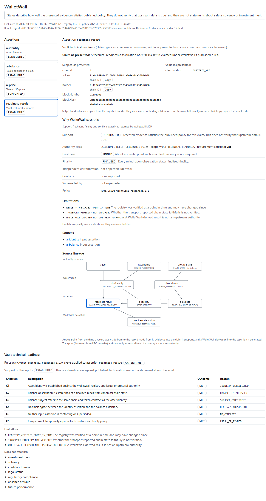

# Copilot Desktop installability and invocation record

Status of this record: **TESTED against the real GitHub Copilot Desktop runtime on Windows; the manual GUI click-through is NOT_PROVEN** (see "What is not proven"). Date: 2026-10-24 (UTC).

## Versions

| Item | Value | How it was read |
| --- | --- | --- |
| GitHub Copilot Desktop app | **1.1.31** | `get_app_info` of the serving app, and `github.exe` file version |
| Copilot CLI / runtime used by the app | **1.0.103** (`copilot-sdk-runtime-1.0.102-0.unstable.r39844011292.g0401dd9\copilot.exe`) | `copilot --version` |
| Windows | **Windows 11 Home 10.0.26200** (build 26200) | `Win32_OperatingSystem` |
| Node.js / npm | **v24.16.0 / 11.13.0** | `node --version` |
| GitHub CLI | 2.102.1 | `gh --version` |

Spec and version drift since the foundation lane: none that affects the plugin. CLI 1.0.103 is the version the foundation lane tested; the Desktop app version (1.1.31) had not been recorded before. The official docs now document the Desktop **Customize → Plugins** flow (browse, add a custom marketplace from a GitHub repository or Git URL, Install) and plugin-shipped canvases, which the foundation lane could not cite; see `GITHUB_COPILOT_INTEGRATION.md` for the full drift record.

## Install source (what was actually used)

The plugin is installed through the supported **marketplace** path, using the smallest possible marketplace: this repository itself.

| Item | Value |
| --- | --- |
| Marketplace manifest | `.github/plugin/marketplace.json` (name `walletwall-private`, one plugin, `source: "./plugin"`, relative path only) |
| Plugin directory | `plugin/` (Agent Plugins 1.0.0, name `walletwall`, version `0.2.0`) |
| Manifest used | `plugin/plugin.json` (digest in `security/plugin-manifest.json`) |
| Registration command (runtime CLI shared with the Desktop app) | `copilot plugin marketplace add <checkout path>` |
| Install command | `copilot plugin install walletwall@walletwall-private` |
| Result | `Plugin "walletwall" installed successfully. Installed 1 skill.` / `Enabled "walletwall@walletwall-private". It is loaded live from <checkout>\plugin ... nothing was copied.` |
| `copilot plugin list --json` | `{ name: "walletwall", marketplace: "walletwall-private", version: "0.2.0", enabled: true, source: "live" }` |

Configuration change in the real Copilot home (`~/.copilot/settings.json`, shared by the CLI and the Desktop app): one `enabledPlugins` entry `walletwall@walletwall-private: true` and one `extraKnownMarketplaces.walletwall-private` entry with a `directory` source. Nothing else changed. A copy of the files as they were before is kept by the operator outside the repository.

Exact MCP launch command (from `plugin/mcp.json`): `node ${PLUGIN_ROOT}/server/walletwall-mcp.mjs` over stdio, no `env`, no `url`. The Copilot runtime reported `walletwall` as a **connected** server with `configSource: "plugin"`.

To publish this later (not done, out of scope): register the private GitHub repository `Wallet-Wall/walletwallrus-copilot` as a marketplace in **Customize → Plugins → marketplace settings → add GitHub repository**. To remove the local install:

```text
copilot plugin uninstall walletwall
copilot plugin marketplace remove walletwall-private
```

The local install is a **live** directory source: it points at the checkout. If that checkout is deleted, uninstall as above.

## What Copilot Desktop showed (new sessions created after the install)

Evidence is the Desktop's own session logs (`events.jsonl`) of four sessions created from the running app, not unit tests.

| What | Observed |
| --- | --- |
| User-visible plugin name | `walletwall` (the Agent Plugins format has no display-name field; the product name WalletWall appears in the skill and canvas names) |
| Tools visible to the Desktop agent | `walletwall-resolve_asset`, `walletwall-normalize_observation`, `walletwall-inspect_evidence`, `walletwall-check_invariants`, `walletwall-trace_provenance`, `walletwall-assess_vault_readiness` (server `walletwall`) |
| Canvas visible | `WalletWall Evidence Explorer` (the name at the time of this record; the canvas is now presented as `WalletWall`), id `walletwall-evidence-explorer`, extension `plugin:walletwall:walletwall-evidence-explorer` |
| Skill | `walletwall-evidence` loaded by the agent when relevant |
| Restart required | **No app restart was needed for sessions created after the install.** An already-open session (the one that did the install) does not gain the plugin. |
| MCP resources visible | **NOT_PROVEN in the Desktop UI.** The resources are proven over the protocol (conformance and manifest tests); the Desktop agent in these sessions did not list or read them |
| Permission prompts shown | **NOT_PROVEN.** The test sessions ran with all permissions allowed (autopilot), so no prompt was exercised |
| Warnings from Desktop | None were recorded in the session logs |

### Real Copilot to MCP workflows (agent output and structured result judged separately)

| # | Workflow | Tool calls observed | A. WalletWall structured result | B. Copilot's prose |
| --- | --- | --- | --- | --- |
| 1 | Asset identity: is `0xA0b8…eB48` on chain 1 canonical USDC? | `resolve_asset` | `REGISTRY_MATCH`, support `PARTIAL`, limitations `REGISTRY_VERIFIED_POINT_IN_TIME`, `NO_AUTHORITATIVE_OBSERVATION`; verification block shows Circle publication and finalized `decimals()` observation | Correct: "does not establish the asset identity" |
| 2 | Evidence inspection of a local fixture file (conformance EVD-001) | `inspect_evidence` | identity `ESTABLISHED/CURRENT`, balance `ESTABLISHED/PINNED/FINALIZED`, price `SUPPORTED/CURRENT`; zero invariant violations | Correct; states quoted exactly with limitations |
| 3 | Deliberately conflicting and stale evidence (CNF-004, FRS-009) | `inspect_evidence`, `check_invariants` (twice each) | balance `CONFLICTING` (1,500,000 vs 1,400,000), invariants INV-00 and INV-10 violated; identity `STALE` | Correct: refused to give one balance, reported `STALE` |
| 4 | Evidence Explorer canvas for the EVD-001 bundle | `list_canvas_capabilities`, `open_canvas`, `invoke_canvas_action get_view` | canvas opened a loopback URL; `get_view` returned the MCP states unchanged | Correct; the agent reported the URL, instance and per-assertion states from `get_view` |

No Copilot overclaim was observed in these four Desktop sessions. Model behavior over a wider prompt set is in `AGENT_EVALS.md`.

## The canvas as rendered (formerly "Evidence Explorer")

The loopback page opened by workflow 4 was fetched from the running Desktop session and inspected in a browser at the time of this record (then headed "WalletWall Evidence Explorer"): all three assertions with the MCP states, selectable assertion detail, limitations and a provenance graph rendered; `localStorage` and `sessionStorage` empty, no cookies, no IndexedDB databases, and the browser's network log showed only `GET /`, `GET /view` and `GET /events` on the page's own loopback origin. The screenshots from that record showed the old heading and were replaced; the images below were captured from the current canvas, rendered in a browser from the same loopback page, with synthetic bundles. They show the WalletWall heading, the chain ID and Copy control next to each address, and the "Sources" and "Source lineage" sections.




## What is not proven

- **GUI click-through.** The Desktop GUI flow **Customize → Plugins → marketplace settings → add → Install** was not driven by a human or an automated UI test in this lane; there is no stable automated interface for it and none was faked. What was proven is that the same configuration the GUI writes is picked up by the Desktop runtime and that new Desktop sessions load the plugin, MCP server, skill and canvas. Whether the **Customize → Installed** list shows the row exactly as expected, whether the GUI asks for confirmation on install, and whether the GUI adds a trust prompt for a local directory marketplace are **NOT_PROVEN**.
- Whether Desktop shows a confirmation before the first call of a plugin MCP tool or canvas action (sessions ran with permissions allowed).
- That the canvas renders correctly inside the Desktop's right-hand panel itself (it was rendered in a browser from the very URL the panel embeds, with the Desktop's own CSS tokens absent).

### Manual acceptance checklist (about five minutes)

1. Open **Customize → Plugins**, use the marketplace settings icon, add `Wallet-Wall/walletwallrus-copilot` (or the local checkout), click **Install** on `walletwall`. Note any prompt or warning.
2. Start a **new session**. Ask: "Is 0xA0b86991c6218b36c1d19D4a2e9Eb0cE3606eB48 on chain 1 definitely canonical USDC?" Expect a `walletwall-resolve_asset` call and an answer that says `PARTIAL`.
3. Ask: "Show the stale-identity fixture in the WalletWall canvas." Expect the canvas (listed as `WalletWall`) in the right panel with `STALE` and the limitations visible. Click Copy next to an address and paste it somewhere harmless: it must equal the full address shown.
4. Under **Customize → Installed**, confirm the plugin, the `walletwall` MCP server and the canvas are listed; note whether the MCP resources appear.
